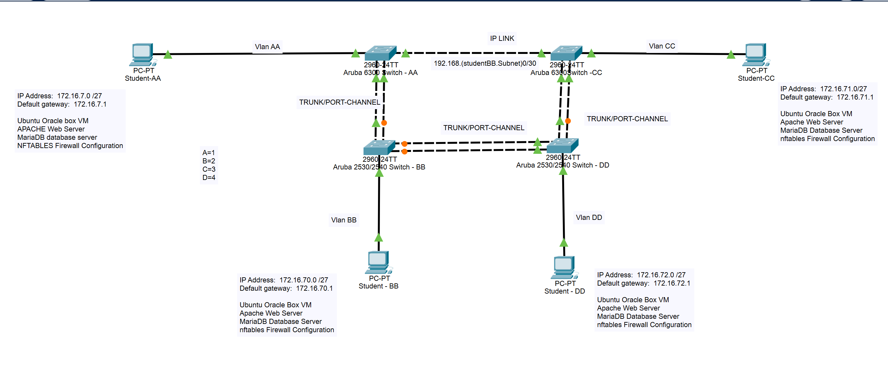

# Aruba 6300 & 2540: OSPF Routing, MariaDB and nftables
A hands-on networking lab that joins two **Aruba 6300 (AOS-CX)** switches with a routed **OSPF** link and two **Aruba 2530/2540** switches with **LACP trunks**, and carries four VLANs (**11, 22, 33 and 44**) across the network. The 6300s route between the VLANs and one of them runs the **DHCP server**, with a **DHCP relay** on the other. Four **Ubuntu 22.04 virtual machines**, one per VLAN, each run **Apache**, a read-only **MariaDB** database and an **nftables** firewall, and every hop is checked with **SSH**, **HTTP**, **MariaDB** and **Wireshark** captures.


**Last updated:** November 2026

---

## 📚 Project Objectives
- Build a four-switch network: two Aruba 6300 switches (Switch-AA, Switch-CC) and two Aruba 2530/2540 switches (Switch-BB, Switch-DD)
- Join Switch-AA and Switch-CC with a routed point-to-point link (`192.168.22.0/30`) and exchange routes with **OSPF** (area 0)
- Join the switches in a chain with **LACP port-channels** that carry VLANs 11, 22, 33 and 44
- Run a **DHCP server on Switch-AA** with one pool per VLAN, and a **DHCP relay** on Switch-CC for VLANs 33 and 44
- Connect one Ubuntu VM to each VLAN and confirm each receives an address and gateway from the switches
- Install **Apache** and a read-only **MariaDB** database on every VM, and reach them from VMs in other VLANs
- Protect each VM with an **nftables** firewall that allows only ICMP, SSH, HTTP, HTTPS and MariaDB
- Disable direct root login over SSH and connect over SSH between the VMs and to the switch
- Capture the SSH, OSPF, HTTP and MariaDB traffic in **Wireshark** and verify the switches with `show` commands

---

## 🗺️ Network Topology


> The Packet Tracer diagram is the template supplied with the project. Its `172.16.7.0`, `70`, `71` and `72` subnet labels are placeholders. The addressing that was built and captured is in [docs/topology.md](docs/topology.md).

---

## 📂 Repository Layout
```
Aruba-6300-2540-OSPF-Routing-MariaDB-and-nftables/
├── configs/
│   ├── aruba-6300-switch-aa.cfg     # 6300 AA: OSPF, LAG 1, VLANs 11/22, DHCP server
│   ├── aruba-6300-switch-cc.cfg     # 6300 CC: OSPF, LAG 2, VLANs 33/44, DHCP relay
│   ├── aruba-2540-switch-bb.cfg     # 2540 BB: LACP trunks and VLANs
│   ├── aruba-2540-switch-dd.cfg     # 2540 DD: LACP trunks and VLANs
│   ├── nftables.conf                # Firewall ruleset used on the VMs
│   ├── mariadb-setup.sql            # Database and read-only user (placeholders)
│   └── sshd_config.snippet          # The sshd_config change made on the VMs
├── docs/
│   ├── topology.md                  # Addressing plan and design notes
│   ├── setup.md                     # Step-by-step build guide
│   ├── verification.md              # Every check, with expected output
│   └── submission.md                # Project summary and references
├── packet-tracer/
│   └── network-diagram.pkt          # Network diagram (Cisco Packet Tracer)
├── screenshots/                     # Proof of each deliverable
├── scripts/
│   └── verify-connectivity.bash     # Optional helper to run the VM-side checks
├── web/
│   └── index.html                   # Template for the Apache test page
├── .gitignore
└── README.md
```

---

## 🧰 Requirements
- Two Aruba 6300 switches running AOS-CX (prompts `Switch-AA#` and `Switch-CC#` in the captures)
- Two Aruba 2530/2540 switches (ArubaOS-Switch CLI, prompts `Switch-BB` and `Switch-DD`)
- Two cables for each LACP trunk, plus one cable for the routed link between the 6300s
- Four Ubuntu 22.04 VMs (built in VMware Workstation), each with:
  - one adapter on the campus network (`ens33`, DHCP)
  - one adapter connected to the lab switches (`ens37`)
- `openssh-server`, `apache2`, `mariadb-server` and `nftables` on every VM
- Wireshark on the VMs for packet capture
- Cisco Packet Tracer to open the `.pkt` diagram

---

## ⚙️ Setup

Full walkthrough: [docs/setup.md](docs/setup.md). The short version:

1. Paste each file from [configs/](configs/) into its switch CLI in configuration mode: `aruba-6300-switch-aa.cfg`, `aruba-6300-switch-cc.cfg`, `aruba-2540-switch-bb.cfg` and `aruba-2540-switch-dd.cfg`.
2. Cable the switches as listed in [docs/topology.md](docs/topology.md) and connect one VM to each VLAN.
3. On each VM, confirm the lab interface received an address from the switch:

   ```bash
   ip -brief link
   ip a
   ```

4. Add a route to each of the other three VLANs through the local gateway (example for the VLAN 22 VM):

   ```bash
   sudo ip route add 172.16.11.0/27 via 172.16.22.1 dev ens37
   sudo ip route add 172.16.33.0/27 via 172.16.22.1 dev ens37
   sudo ip route add 172.16.44.0/27 via 172.16.22.1 dev ens37
   ```

5. Install Apache and publish the test page:

   ```bash
   sudo apt update
   sudo apt install -y apache2
   sudo systemctl enable --now apache2
   sudo cp web/index.html /var/www/html/index.html
   ```

6. Install MariaDB, let it listen on the network, and create the read-only user with [configs/mariadb-setup.sql](configs/mariadb-setup.sql):

   ```bash
   sudo apt install -y mariadb-server
   sudo vim /etc/mysql/mariadb.conf.d/50-server.cnf     # set: bind-address = 0.0.0.0
   sudo systemctl restart mariadb
   sudo mariadb
   ```

7. Apply the firewall:

   ```bash
   sudo cp configs/nftables.conf /etc/nftables.conf
   sudo nft -f /etc/nftables.conf
   sudo systemctl enable --now nftables
   ```

8. Disable root login in `/etc/ssh/sshd_config`, restart SSH, and exchange keys:

   ```bash
   sudo vim /etc/ssh/sshd_config      # set: PermitRootLogin no
   sudo systemctl restart ssh
   ssh-keygen
   ssh-copy-id <username>@<other-vm-ip>
   ```

9. From a VM in another VLAN, test the web page, the database and SSH:

   ```bash
   links http://172.16.11.11
   sudo apt install -y mariadb-client
   mysql -h 172.16.11.11 -u <db_user> -p
   ssh <username>@172.16.11.11
   ssh student@172.16.22.1
   ```

---

## 🖥️ Switch Configuration

The full files are in [configs/](configs/). Highlights:

**Switch-AA (Aruba 6300)** – OSPF, routed link to CC, LAG 1 and the DHCP server

```
router ospf 1
    router-id 1.1.1.1
    area 0.0.0.0

interface 1/1/1
    routing
    ip address 192.168.22.1/30
    ip ospf 1 area 0.0.0.0

interface lag 1
    no routing
    vlan trunk native 1
    vlan trunk allowed all
    lacp mode active

interface vlan 11
    ip address 172.16.11.1/27
    ip ospf 1 area 0.0.0.0
interface vlan 22
    ip address 172.16.22.1/27
    ip ospf 1 area 0.0.0.0
```

**Switch-CC (Aruba 6300)** – OSPF, LAG 2 and the DHCP relay

```
router ospf 1
    router-id 2.2.2.2
    area 0.0.0.0

interface 1/1/1
    routing
    ip address 192.168.22.2/30
    ip ospf 1 area 0.0.0.0

interface vlan 33
    ip address 172.16.33.1/27
    ip helper-address 192.168.22.1
    ip ospf 1 area 0.0.0.0
interface vlan 44
    ip address 172.16.44.1/27
    ip helper-address 192.168.22.1
    ip ospf 1 area 0.0.0.0
```

**Switch-BB and Switch-DD (Aruba 2530/2540)** – LACP trunks and VLANs

```
! Switch-BB                          ! Switch-DD
trunk 2-3 trk1 lacp                  trunk 4-5 trk2 lacp
trunk 4-5 trk2 lacp                  trunk 2-3 trk3 lacp
int vlan 22                          int vlan 44
    untagged 1                           untagged 1
    tagged Trk1-Trk2                     tagged Trk2-Trk3
```

---

## ✅ Usage & Verification

Every check below has expected output and a screenshot in [docs/verification.md](docs/verification.md).

**On Switch-AA**

```
Switch-AA# sh ip int br
Interface         IP Address            Interface Status
                                        link/admin
1/1/1             192.168.22.1/30       up/up
vlan1             No Address            up/up
vlan11            172.16.11.1/27        up/up
vlan22            172.16.22.1/27        up/up
```

**On Switch-CC** – OSPF has learned the VLAN 11 and VLAN 22 networks from AA

```
Switch-CC# sh ip route
Prefix              Nexthop          Interface   Origin/Type  Distance/Metric
172.16.11.0/27      192.168.22.1     1/1/1       O            [110/200]
172.16.22.0/27      192.168.22.1     1/1/1       O            [110/200]
172.16.33.0/27      -                vlan33      C            [0/0]
172.16.44.0/27      -                vlan44      C            [0/0]
192.168.22.0/30     -                1/1/1       C            [0/0]
```

**On a VM** (VLAN 22 VM, excerpt)

```
$ ip route
default via 172.16.22.1 dev ens37 proto dhcp src 172.16.22.13 metric 20101
172.16.11.0/27 via 172.16.22.1 dev ens37
172.16.22.0/27 dev ens37 proto kernel scope link src 172.16.22.13 metric 101
172.16.33.0/27 via 172.16.22.1 dev ens37
172.16.44.0/27 via 172.16.22.1 dev ens37
```

**Database** – a VM in another VLAN logs in with the read-only user, and `CREATE DATABASE` is refused with `ERROR 1044 (42000): Access denied`.

**SSH and OSPF** – the VMs log in to each other across the network and to the switches, and Wireshark shows the SSHv2 handshake and the OSPF `Hello Packet` exchange to `224.0.0.5`.

---

## 🔍 How It Works
1. **Routed link and OSPF** – Switch-AA (`1.1.1.1`) and Switch-CC (`2.2.2.2`) are joined by `192.168.22.0/30` and advertise their VLAN interfaces in OSPF area 0, so every VLAN is reachable from every other.
2. **LACP trunks** – AA `lag 1` ↔ BB `trk1`, BB `trk2` ↔ DD `trk2`, and DD `trk3` ↔ CC `lag 2`. Each is a two-port LACP bundle carrying all four VLANs.
3. **VLANs** – Each VM sits in its own VLAN: VLAN 11 on AA `1/1/4`, VLAN 22 on BB port 1, VLAN 33 on CC `1/1/4` and VLAN 44 on DD port 1.
4. **Spanning tree** – All switches run RPVST, so the trunk chain is loop-free.
5. **DHCP** – Switch-AA holds a pool for each VLAN. Switch-CC forwards VLAN 33 and VLAN 44 requests to `192.168.22.1` with `ip helper-address`.
6. **Routes on the VMs** – Each VM also has a campus adapter (`ens33`) that wins the default route by metric. Static routes to the other VLANs via the local gateway send lab traffic across the switches.
7. **Apache** – Each VM serves a test page from `/var/www/html`, reachable from the other VLANs.
8. **MariaDB** – Each VM has a `labdb` database and a user with `SELECT` only, allowed from any host. Connections arrive on TCP 3306.
9. **nftables** – The input policy is `drop`. Loopback, established connections, ICMP and ports 22, 80, 443 and 3306 are accepted.
10. **SSH** – The VMs set `PermitRootLogin no` and use `ssh-keygen` key pairs. The 6300s accept SSH on their gateway addresses.

---

## 🖼️ Screenshots
| # | Screenshot | File |
|---|------------|------|
| 1 | Network diagram | [01-network-diagram.png](screenshots/01-network-diagram.png) |
| 2 | SSH to the switch from a VM (Wireshark), VM A | [02-ssh-to-switch-vm-a.png](screenshots/02-ssh-to-switch-vm-a.png) |
| 3 | SSH to the switch from a VM (Wireshark), VM B | [03-ssh-to-switch-vm-b.png](screenshots/03-ssh-to-switch-vm-b.png) |
| 4 | OSPF Hello packets (Wireshark), VLAN 44 VM | [04-ospf-hello-wireshark-a.png](screenshots/04-ospf-hello-wireshark-a.png) |
| 5 | OSPF Hello packets (Wireshark), VLAN 22 VM | [05-ospf-hello-wireshark-b.png](screenshots/05-ospf-hello-wireshark-b.png) |
| 6 | SSH VM to VM (Wireshark), VM A | [06-ssh-vm-to-vm-a.png](screenshots/06-ssh-vm-to-vm-a.png) |
| 7 | SSH VM to VM (Wireshark), VM B | [07-ssh-vm-to-vm-b.png](screenshots/07-ssh-vm-to-vm-b.png) |
| 8 | HTTP request to a partner's Apache server (Wireshark), VM A | [08-http-request-wireshark-a.png](screenshots/08-http-request-wireshark-a.png) |
| 9 | HTTP request to a partner's Apache server (Wireshark), VM B | [09-http-request-wireshark-b.png](screenshots/09-http-request-wireshark-b.png) |
| 10 | Apache test page, VM in VLAN 33 | [10-apache-page-vm-1.png](screenshots/10-apache-page-vm-1.png) |
| 11 | Apache test page, VM in VLAN 22 | [11-apache-page-vm-2.png](screenshots/11-apache-page-vm-2.png) |
| 12 | Apache test page, VM in VLAN 11 | [12-apache-page-vm-3.png](screenshots/12-apache-page-vm-3.png) |
| 13 | Apache test page, VM in VLAN 11 (second capture) | [13-apache-page-vm-4.png](screenshots/13-apache-page-vm-4.png) |
| 14 | MariaDB login across VLANs (Wireshark `mysql`), VM A | [14-mariadb-login-wireshark-a.png](screenshots/14-mariadb-login-wireshark-a.png) |
| 15 | MariaDB login across VLANs (Wireshark `mysql`), VM B | [15-mariadb-login-wireshark-b.png](screenshots/15-mariadb-login-wireshark-b.png) |
| 16 | Read-only user denied `CREATE DATABASE`, VM A | [16-mariadb-read-only-denied-a.png](screenshots/16-mariadb-read-only-denied-a.png) |
| 17 | Read-only user denied `CREATE DATABASE`, VM B | [17-mariadb-read-only-denied-b.png](screenshots/17-mariadb-read-only-denied-b.png) |
| 18 | `ip a` on a VM, VM A | [18-ip-a-vm-a.png](screenshots/18-ip-a-vm-a.png) |
| 19 | `ip a` on a VM, VM B | [19-ip-a-vm-b.png](screenshots/19-ip-a-vm-b.png) |
| 20 | `ip route` on the VLAN 44 VM | [20-ip-route-vm-a.png](screenshots/20-ip-route-vm-a.png) |
| 21 | `ip route` on the VLAN 22 VM | [21-ip-route-vm-b.png](screenshots/21-ip-route-vm-b.png) |
| 22 | `sshd_config` change, VM A | [22-sshd-config-permitrootlogin-a.png](screenshots/22-sshd-config-permitrootlogin-a.png) |
| 23 | `sshd_config` change, VM B | [23-sshd-config-permitrootlogin-b.png](screenshots/23-sshd-config-permitrootlogin-b.png) |
| 24 | nftables ruleset (reference copy) | [24-nftables-ruleset-reference.png](screenshots/24-nftables-ruleset-reference.png) |
| 25 | nftables ruleset in the editor | [25-nftables-conf-editor.png](screenshots/25-nftables-conf-editor.png) |
| 26 | Switch-AA `sh ip int br` | [26-switch-aa-ip-interface-brief.png](screenshots/26-switch-aa-ip-interface-brief.png) |
| 27 | Switch-BB `sh interfaces brief` | [27-switch-bb-interfaces-brief.png](screenshots/27-switch-bb-interfaces-brief.png) |
| 28 | Switch-CC `sh ip int br` | [28-switch-cc-ip-interface-brief.png](screenshots/28-switch-cc-ip-interface-brief.png) |
| 29 | Switch-DD `sh interfaces brief` | [29-switch-dd-interfaces-brief.png](screenshots/29-switch-dd-interfaces-brief.png) |
| 30 | Switch-AA `sh vlan` | [30-switch-aa-show-vlan.png](screenshots/30-switch-aa-show-vlan.png) |
| 31 | Switch-BB `sh vlan` | [31-switch-bb-show-vlan.png](screenshots/31-switch-bb-show-vlan.png) |
| 32 | Switch-CC `sh vlan` | [32-switch-cc-show-vlan.png](screenshots/32-switch-cc-show-vlan.png) |
| 33 | Switch-DD `show vlan` | [33-switch-dd-show-vlan.png](screenshots/33-switch-dd-show-vlan.png) |
| 34 | Switch-AA `sh spanning-tree` | [34-switch-aa-spanning-tree.png](screenshots/34-switch-aa-spanning-tree.png) |
| 35 | Switch-CC `sh spanning-tree` | [35-switch-cc-spanning-tree.png](screenshots/35-switch-cc-spanning-tree.png) |
| 36 | Switch-AA `sh dhcp-server` | [36-switch-aa-dhcp-server.png](screenshots/36-switch-aa-dhcp-server.png) |
| 37 | Switch-AA DHCP pool `vlan44` | [37-switch-aa-dhcp-pool-vlan44.png](screenshots/37-switch-aa-dhcp-pool-vlan44.png) |
| 38 | Switch-CC `sh ip route` (OSPF routes) | [38-switch-cc-ip-route-ospf.png](screenshots/38-switch-cc-ip-route-ospf.png) |

---

## 📖 References
- [ArubaOS 8.x CLI Reference Guide](https://arubanetworking.hpe.com/techdocs/ArubaOS-8.x-Books/ArubaOS-8.x-CLI-Reference-Guide.pdf)
- [HPE Support – document a00021327en_us](https://support.hpe.com/hpesc/public/docDisplay?docId=a00021327en_us)
- [HPE Support – document a00055715en_us](https://support.hpe.com/hpesc/public/docDisplay?docId=a00055715en_us&docLocale=en_US)
- [MariaDB Documentation](https://mariadb.com/kb/en/documentation/)
- [nftables Wiki](https://wiki.nftables.org/)
