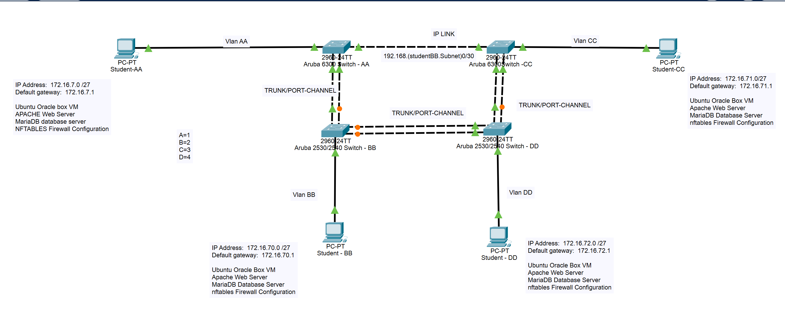

# 🗺️ Topology & Addressing Plan

This document describes the network designed for this lab.



The editable diagram is in [`packet-tracer/network-diagram.pkt`](../packet-tracer/network-diagram.pkt) (open with Cisco Packet Tracer).

> The diagram is the template supplied with the project. Its `172.16.7.0`, `172.16.70.0`, `172.16.71.0` and `172.16.72.0` subnet labels and the "Oracle Box" VM labels are placeholders. The addressing below is what was built and captured, and the screenshots show the VMs ran in VMware Workstation.

---

## Devices

| Device | Role | Notes |
|--------|------|-------|
| Switch-AA (Aruba 6300) | Layer 3 switch, OSPF router `1.1.1.1`, DHCP server, SSH server | VLANs 11 and 22 gateways |
| Switch-CC (Aruba 6300) | Layer 3 switch, OSPF router `2.2.2.2`, DHCP relay | VLANs 33 and 44 gateways |
| Switch-BB (Aruba 2530/2540) | Layer 2 switch | VLAN 22 access port |
| Switch-DD (Aruba 2530/2540) | Layer 2 switch | VLAN 44 access port |
| Ubuntu VMs (x4) | Client, Apache, MariaDB, nftables | Ubuntu 22.04, one per VLAN |

---

## Addressing Scheme

- **Custom scheme:** `/27` subnets (32 addresses each, 30 usable hosts)
- The VLAN number is used as the third octet, which makes each network easy to recognise.
- **Routed link AA ↔ CC:** `192.168.22.0/30` (AA `192.168.22.1`, CC `192.168.22.2`)

| VLAN | Name   | Network          | Netmask           | Gateway (SVI)  | DHCP range                      | Gateway device |
|------|--------|------------------|-------------------|----------------|---------------------------------|----------------|
| 11   | VLAN11 | `172.16.11.0/27` | `255.255.255.224` | `172.16.11.1`  | `172.16.11.10` – `172.16.11.30` | Switch-AA      |
| 22   | VLAN22 | `172.16.22.0/27` | `255.255.255.224` | `172.16.22.1`  | `172.16.22.10` – `172.16.22.30` | Switch-AA      |
| 33   | VLAN33 | `172.16.33.0/27` | `255.255.255.224` | `172.16.33.1`  | `172.16.33.10` – `172.16.33.30` | Switch-CC      |
| 44   | VLAN44 | `172.16.44.0/27` | `255.255.255.224` | `172.16.44.1`  | `172.16.44.10` – `172.16.44.30` | Switch-CC      |

---

## Switch Links

| From | To | Type |
|------|----|------|
| AA `1/1/1` | CC `1/1/1` | Routed, `192.168.22.0/30`, OSPF area 0 |
| AA `1/1/2`, `1/1/3` (`lag 1`) | BB ports 2, 3 (`trk1`) | LACP trunk |
| BB ports 4, 5 (`trk2`) | DD ports 4, 5 (`trk2`) | LACP trunk |
| DD ports 2, 3 (`trk3`) | CC `1/1/2`, `1/1/3` (`lag 2`) | LACP trunk |

## VM Connections

| VLAN | Switch port | Mode |
|------|-------------|------|
| 11 | AA `1/1/4` | Access |
| 22 | BB port 1 | Untagged |
| 33 | CC `1/1/4` | Access |
| 44 | DD port 1 | Untagged |

---

## VM Network Interfaces

Each VM has two network adapters:

1. `ens33` – campus network (DHCP, `10.33.35.x`). It holds the metric 100 default route.
2. `ens37` – lab switches (DHCP from the Aruba DHCP server). It holds a metric 20101 default route.

Because the campus adapter wins the default route, each VM also needs a route to the other three VLANs through its local gateway:

```bash
sudo ip route add 172.16.11.0/27 via 172.16.22.1 dev ens37
```

Addresses seen in the captures: VLAN 11 VM `172.16.11.11`, VLAN 22 VM `172.16.22.13`, VLAN 33 VM `172.16.33.15`, VLAN 44 VM `172.16.44.9`.

---

## Design Notes

- **DHCP relay:** Switch-CC has no DHCP server of its own. `ip helper-address 192.168.22.1` on VLAN 33 and VLAN 44 forwards requests across the routed link to the pools on Switch-AA.
- **Pool for VLAN 44:** The capture of the running configuration shows the range starting at `172.16.44.1`, the gateway address. The configuration file in this repo starts the range at `172.16.44.10` like the other pools. The VLAN 44 VM in the captures holds `172.16.44.9`, which falls inside that wider range.
- **Loop prevention:** The four switches form a chain of trunks (AA – BB – DD – CC). The only link that closes the ring is the routed AA ↔ CC link, which is Layer 3, so there is no Layer 2 loop. RPVST runs on every switch.
